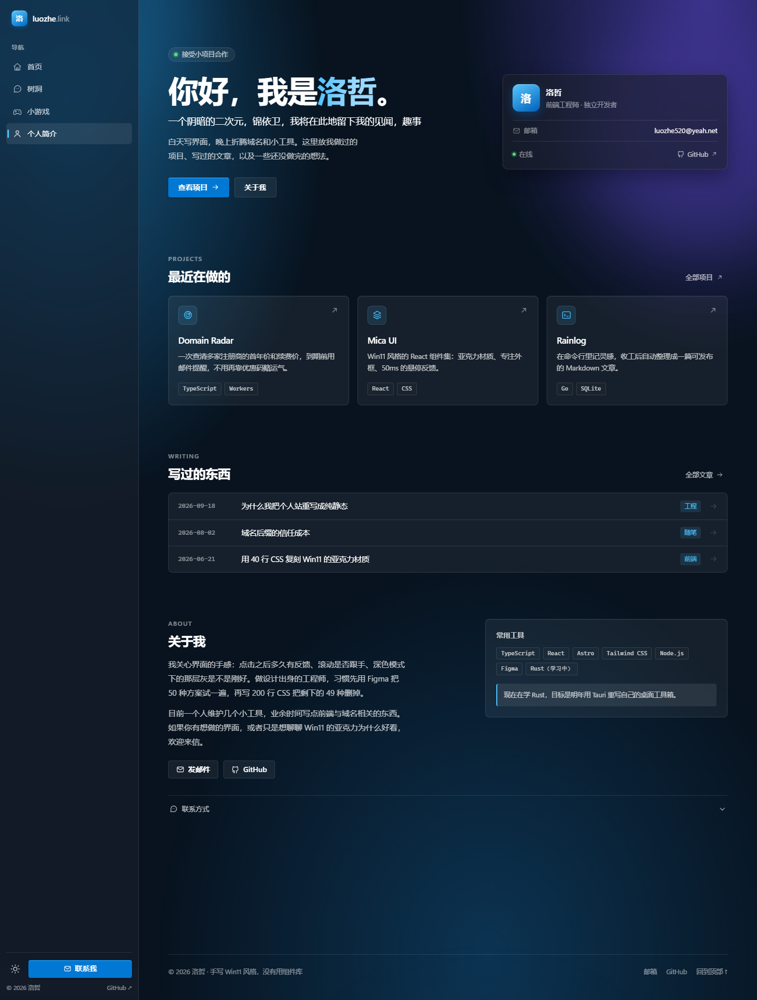
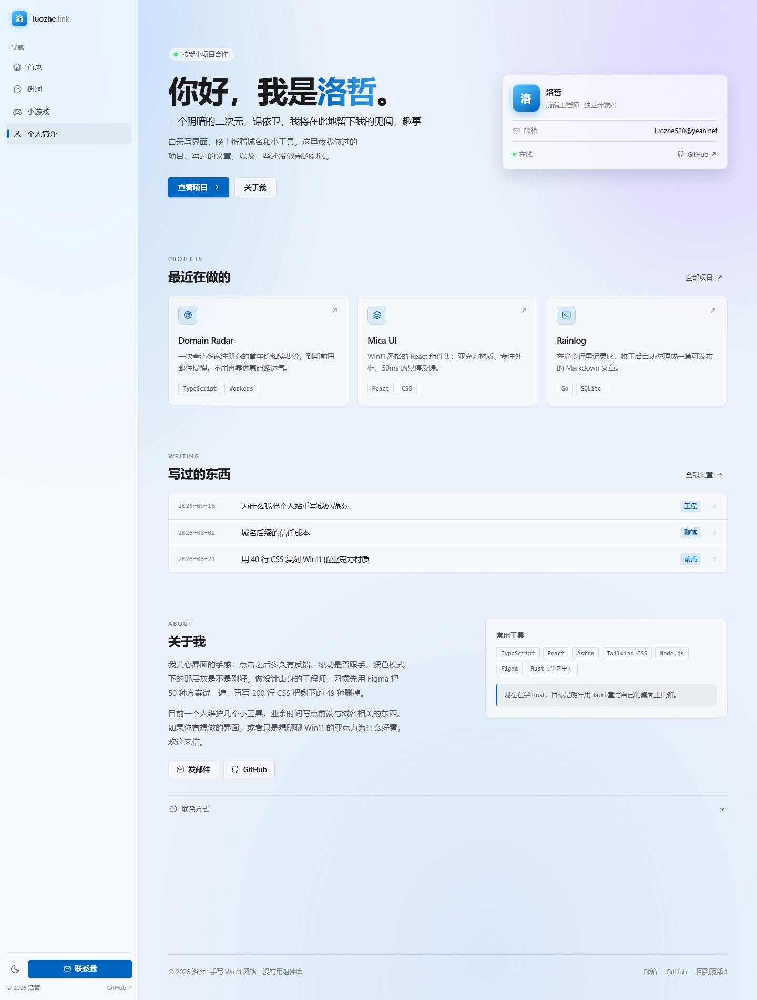

# 洛哲 · 个人主页（Win11 / Fluent 风格）

不依赖组件库、手写 Win11 质感的个人主页模板：亚克力（Acrylic）顶栏、Mica 壁纸、8px 圆角、Segoe UI Variable、跟随指针的 Reveal 柔光，深色 / 浅色两套主题。

## 快速开始

```bash
pnpm install
pnpm dev        # 打开终端提示的地址（默认 http://localhost:5173）
```

构建与本地预览：

```bash
pnpm build      # 类型检查 + 产出 dist/
pnpm preview
```

> 若 `pnpm install` 提示 `Ignored build scripts: esbuild`，运行 `pnpm approve-builds` 勾选 esbuild 即可（本项目已在 `package.json` 的 `pnpm.onlyBuiltDependencies` 里声明）。

## 页面结构

左侧固定侧边栏导航，从上到下：**首页 / 树洞 / 小游戏 / 个人简介**；侧栏底部是主题切换、联系按钮和版权。≤900px 时侧栏收成抽屉，由左上角菜单按钮唤出（Esc 或点遮罩关闭）。

| 路径 | 内容 |
| --- | --- |
| `/` | 首页（占位，等待内容） |
| `/shudong` | 树洞（占位） |
| `/games` | 小游戏（占位） |
| `/profile` | 个人简介：原来的那一整页（Hero + 项目 + 文章 + 关于） |

路由是手写的，没有引入 react-router：`src/router.tsx` 用 `history.pushState` + 自定义事件，`Link` 组件负责拦截点击。部署时需要把未知路径回退到 `index.html`（nginx 的 `try_files` 已经配好）。本地用 `python scripts/preview.py 5173` 预览时也带了同样的回退。

## 随机背景图

每次打开页面随机换一张壁纸，横屏和竖屏各用一套图库。

```
public/backgrounds/
  landscape/   # 横屏用（电脑、横放的平板）
  portrait/    # 竖屏用（手机）
```

1. 按方向把图片丢进对应目录（`.webp` / `.avif` / `.jpg` / `.png`）
2. 运行 `pnpm backgrounds` 生成清单（`pnpm dev` 和 `pnpm build` 会自动跑）
3. 刷新页面，每次加载随机一张

选图规则：竖屏（宽 < 高）只从 `portrait/` 里挑，横屏只从 `landscape/` 里挑；如果某一侧是空的，会退回到另一侧，两边都空就保持原来的渐变背景。移动端旋转屏幕时会自动换成新方向的图库。

图片建议：横图 2400–2560px 宽、竖图 1200×2000 左右、单张 ≤300KB、文件名用英文数字。图片会随仓库提交，张数多了注意体积。

实现：`scripts/gen-backgrounds.mjs` 扫描两个目录生成 `src/data/backgrounds.generated.ts`；`src/hooks/useBackground.ts` 根据 `matchMedia("(orientation: portrait)")` 选库、预加载完成后淡入（0.9s），并监听旋转。有图片时侧栏自动改用不透明底色，渐变光斑降到 0.22。

## 目录

```
src/
  data/site.ts          所有文案：名字、简介、项目、文章、联系方式
  hooks/useTheme.ts     深浅色切换（跟随系统 + localStorage + ?theme= 参数）
  hooks/useMediaQuery.ts 媒体查询（决定抽屉是 inert 还是常驻）
  router.tsx            history 路由 + Link
  routes.ts             四个页面的路径 / 标题
  pages/                ProfilePage、PlaceholderPage
  components/           Sidebar / MobileHeader / Hero / Projects / Posts / About / Footer
  styles/global.css     设计 token、壁纸、基础排版
  styles/components.css 各区块样式
```

## 想改什么，改哪里

| 想改 | 位置 |
| --- | --- |
| 颜色、圆角、模糊、字体 | `src/styles/global.css` 顶部的 `:root` 与 `[data-theme="light"]` |
| 强调色 | `--accent` / `--accent-hover` / `--accent-text` |
| 名字、简介、状态 | `src/data/site.ts` 的 `site` |
| 项目卡片 | `projects` 数组（增删自动排版） |
| 文章列表 | `posts` 数组 |
| 侧栏导航项 / 图标 | `src/routes.ts` + `Sidebar.tsx` 的 `icons` 映射 |
| 头像文字 | `Hero.tsx` 与 `Sidebar.tsx` 里的「洛」 |

主题默认跟随系统，切换后写入 `localStorage`；用 `?theme=light` / `?theme=dark` 可以强制预览某一套。

## 已经处理的细节

- 内联脚本在首帧前设置主题，避免深色页面「闪白」
- 三个响应式断点：960（Hero 单列）、900（侧栏变抽屉）、620（手机排版）
- 侧栏可折叠（内容区左上角的按钮），状态存 `localStorage`；折叠后只留图标，链接带 `title` 和 `aria-label`
- `prefers-reduced-motion`：关掉入场动画与光效延迟
- 键盘可达：跳到正文、`:focus-visible` 环、主题按钮有 aria-label
- 抽屉关闭时侧栏设 `inert`，Tab 不会跳进看不见的菜单
- 卡片使用 `backdrop-filter` 做亚克力，低端设备会自动退化为半透明纯色

## 技术栈

React 19 + TypeScript + Vite，零 UI 依赖，CSS 约 1100 行。以后想接 shadcn/ui、Tailwind 也不会冲突。

## 预览

| 深色 | 浅色 |
| --- | --- |
|  |  |

手机端：`preview/mobile.png`
